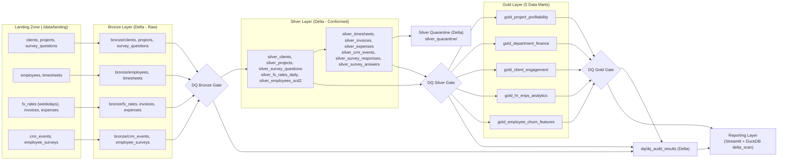
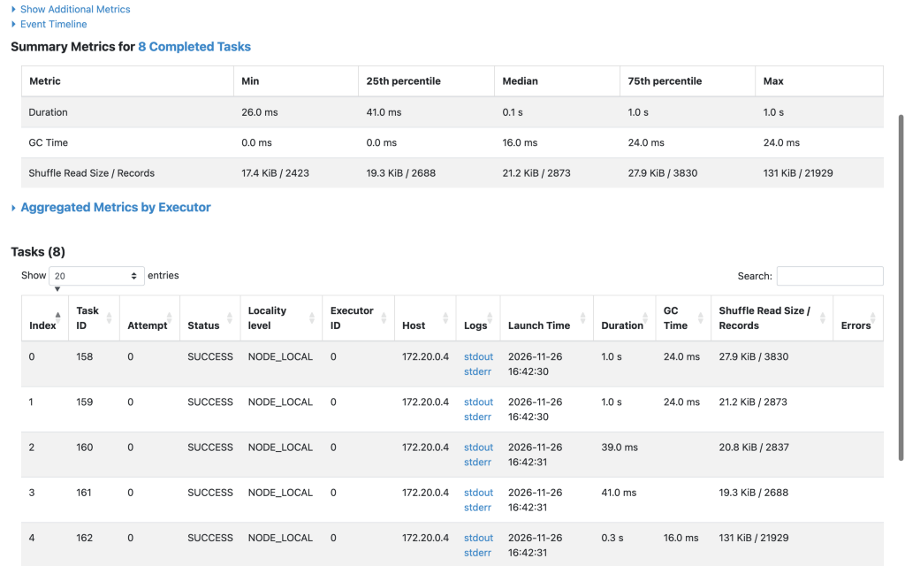
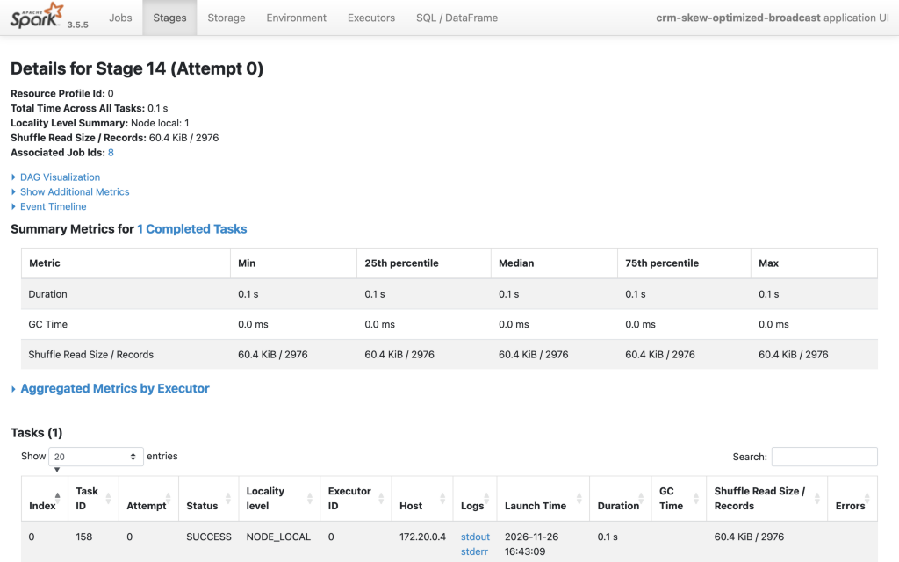

# Lakehouse Architecture Design Document

> **Phase 0 Baseline:** This document establishes the shared data contracts, SCD Type 2 convention, tie-breaker policies, partitioning rules, and DQ gate specifications derived directly from [`STUDENT_ASSIGNMENT.md`](./STUDENT_ASSIGNMENT.md) and [`SANITY_CHECKS.md`](./SANITY_CHECKS.md). Section 5 (Spark UI skew benchmarks & screenshots) will be completed in Phase 3 upon running `transform_crm_events.py`.

---

## 1. System & Medallion Architecture Diagram



---

## 2. Storage Format & Partitioning Strategy

All tables are stored in **Delta Lake** format under `LAKEHOUSE_ROOT` (`/opt/workspace/lakehouse` in Docker). Shared I/O helpers in `spark_jobs/common/io.py` enforce these write semantics across every domain job:

| Layer | Path Pattern | Partition Column(s) | Write / Idempotency Strategy |
| :--- | :--- | :--- | :--- |
| **Bronze (Full Load)** | `lakehouse/bronze/<table>` | None | Full overwrite (`write_delta_overwrite`) |
| **Bronze (Daily Batch)** | `lakehouse/bronze/<table>` | `_batch_date` | Atomic partition replace via `replaceWhere` (`write_delta_partition`); empty batch deletes stale partition |
| **Silver (Dimensions & FX)** | `lakehouse/silver/<table>` | None | Full overwrite (`silver_clients`, `silver_projects`, `silver_survey_questions`, `silver_fx_rates_daily`, `silver_employees_scd2`) |
| **Silver (Daily Facts & Surveys)** | `lakehouse/silver/<table>` | `_batch_date` | Atomic partition replace via `replaceWhere` (`write_delta_partition`) |
| **Silver Quarantine** | `lakehouse/silver_quarantine/<table>` | `_batch_date` | Atomic partition replace / delete on empty (`write_quarantine`) |
| **Gold (5 Marts)** | `lakehouse/gold/<table>` | None | Full idempotent overwrite (`write_delta_overwrite`) recomputed up to `batch_date` |
| **DQ Audit** | `lakehouse/dq/dq_audit_results` | `batch_date` | Delete `(batch_date, layer, table_name)` + append (`write_audit_results`) |

---

## 3. Data Contracts (Bronze, Silver & Gold Schemas)

All table names, column names, types, and keys follow `docs/STUDENT_ASSIGNMENT.md` and `docs/SANITY_CHECKS.md`.

### 3.1 Bronze Layer Contracts

Every Bronze table appends three technical metadata columns via `add_bronze_metadata`:
- `_batch_date` (`date`)
- `_ingested_at` (`timestamp`)
- `_source_file` (`string`)

| Table | Load Type | Raw Columns (Zero Lossy Transformations) |
| :--- | :--- | :--- |
| `bronze/clients` | Full Load CSV | `client_id: string`, `client_name: string`, `tier: string` |
| `bronze/projects` | Full Load CSV | `project_id: string`, `client_id: string`, `budget_eur: double`, `status: string` |
| `bronze/survey_questions` | Full Load JSON | `question_id: string`, `dimension: string`, `scale_min: int`, `scale_max: int`, `prompt_text: string` |
| `bronze/employees` | Daily Snapshot CSV | `emp_id`, `full_name`, `department`, `role`, `seniority_level`, `hourly_rate_eur`, `hire_date`, `last_promotion_date`, `work_mode`, `distance_km`, `manager_id`, `is_active`, `termination_date`, `churn_type`, `snapshot_date` (all raw `string` in Bronze) |
| `bronze/timesheets` | Daily Parquet | `ts_id: string`, `emp_id: string`, `project_id: string`, `work_date: date`, `hours: double` |
| `bronze/fx_rates` | Weekday-Only JSON | `rate_date: string`, `currency_from: string`, `currency_to: string`, `rate: double` (missing Sat/Sun files skipped gracefully) |
| `bronze/invoices` | Daily JSONL | `inv_id: string`, `client_id: string`, `project_id: string`, `amount: double`, `currency: string`, `issued_at: string`, `paid_at: string` (raw ISO & `DD.MM.YYYY` strings preserved) |
| `bronze/expenses` | Daily CSV | `exp_id: string`, `department: string`, `category: string`, `amount: double`, `currency: string`, `expense_date: string` |
| `bronze/crm_events` | Daily JSONL | `event_id: string`, `client_id: string`, `event_type: string`, `timestamp: string`, `payload: string` (raw nested JSON preserved) |
| `bronze/employee_surveys` | Daily Pulse JSONL | `survey_id: string`, `emp_id: string`, `submitted_at: string`, `enps_score: int`, `overall_comment: string`, `answers: array<struct<question_id:string, dimension:string, numeric_score:int, written_answer:string>>` |

### 3.2 Silver Layer Contracts

Every Silver quarantine table (`silver_quarantine/<table>`) preserves the source columns plus `dq_reasons: array<string>` and `_batch_date: date`.

| Table | Primary Key | Partition | Columns & Types |
| :--- | :--- | :--- | :--- |
| `silver_clients` | `client_id` | None | `client_id: string`, `client_name: string`, `tier: string`, `_batch_date: date`, `_ingested_at: timestamp`, `_source_file: string`, `_silver_updated_at: timestamp` |
| `silver_projects` | `project_id` | None | `project_id: string`, `client_id: string`, `budget_eur: double`, `status: string`, `_batch_date: date`, `_silver_updated_at: timestamp` |
| `silver_survey_questions` | `question_id` | None | `question_id: string`, `dimension: string`, `scale_min: int`, `scale_max: int`, `prompt_text: string`, `_batch_date: date`, `_silver_updated_at: timestamp` |
| `silver_employees_scd2` | `(emp_id, valid_from)` | None | `emp_id: string`, `full_name: string`, `department: string`, `role: string`, `seniority_level: string`, `hourly_rate_eur: double`, `hire_date: date`, `last_promotion_date: date`, `work_mode: string`, `distance_km: double`, `manager_id: string`, `is_active: boolean`, `termination_date: date`, `churn_type: string`, `valid_from: date`, `valid_to: date`, `is_current: boolean`, `_silver_updated_at: timestamp` |
| `silver_timesheets` | `ts_id` | `_batch_date` | `ts_id: string`, `emp_id: string`, `project_id: string`, `work_date: date`, `hours: double`, `_batch_date: date`, `_silver_updated_at: timestamp` |
| `silver_fx_rates_daily` | `(rate_date, currency_from, currency_to)` | None | `rate_date: date`, `currency_from: string`, `currency_to: string`, `rate: double`, `_is_forward_filled: boolean`, `_silver_updated_at: timestamp` |
| `silver_invoices` | `inv_id` | `_batch_date` | `inv_id: string`, `client_id: string`, `project_id: string`, `amount: double`, `currency: string`, `issued_date: date`, `paid_date: date`, `is_credit_note: boolean`, `amount_eur: double`, `net_amount_eur: double`, `_batch_date: date`, `_silver_updated_at: timestamp` |
| `silver_expenses` | `exp_id` | `_batch_date` | `exp_id: string`, `department: string`, `category: string`, `amount: double`, `currency: string`, `expense_date: date`, `amount_eur: double`, `_batch_date: date`, `_silver_updated_at: timestamp` |
| `silver_crm_events` | `event_id` | `_batch_date` | `event_id: string`, `client_id: string`, `client_name: string`, `client_tier: string`, `event_type: string`, `event_timestamp: timestamp`, `event_date: date`, `payload_raw: string`, `path: string`, `referrer: string`, `duration_sec: int`, `device: string`, `ticket_id: string`, `severity: string`, `module: string`, `sla_hours: int`, `opportunity_id: string`, `stage: string`, `arr_delta_eur: double`, `probability: double`, `endpoint: string`, `status_code: int`, `latency_ms: int`, `region: string`, `meeting_type: string`, `attendees_count: int`, `outcome: string`, `next_step_days: int`, `_batch_date: date`, `_silver_updated_at: timestamp` |
| `silver_survey_responses` | `survey_id` | `_batch_date` | `survey_id: string`, `emp_id: string`, `survey_wave: int`, `submitted_at: timestamp`, `enps_score: int`, `enps_category: string`, `overall_comment: string`, `_batch_date: date`, `_silver_updated_at: timestamp` |
| `silver_survey_answers` | `(survey_id, question_id)` | `_batch_date` | `survey_id: string`, `emp_id: string`, `survey_wave: int`, `question_id: string`, `dimension: string`, `numeric_score: int`, `written_answer: string`, `has_written_comment: boolean`, `_batch_date: date`, `_silver_updated_at: timestamp` |

### 3.3 Gold Layer Contracts

| Table | Grain / Primary Key | Required Metrics & Columns |
| :--- | :--- | :--- |
| `gold_project_profitability` | `(project_id, year_month)` | `project_id`, `client_id`, `year_month`, `budget_eur`, `invoiced_revenue_eur`, `credit_notes_eur`, `net_revenue_eur`, `billable_hours`, `labor_cost_eur`, `gross_margin_eur`, `gross_margin_pct`, `budget_utilization_pct` |
| `gold_department_finance` | `(department, category, year_month)` | `department`, `category`, `year_month`, `total_expense_eur`, `expense_count`, `headcount`, `billable_utilization_pct` |
| `gold_client_engagement` | `(client_id, client_tier, event_type, event_date)` | `client_id`, `client_tier`, `event_type`, `event_date`, `event_count`, `avg_api_latency_ms`, `critical_ticket_count`, `pipeline_arr_delta_eur` |
| `gold_hr_enps_analytics` | `(department, seniority_level, work_mode, survey_wave)` | `department`, `seniority_level`, `work_mode`, `survey_wave`, `respondent_count`, `enps_score`, `avg_work_life_balance` (`Q02`) .. `avg_recognition` (`Q10`), `voluntary_attrition_rate`, `involuntary_attrition_rate` |
| `gold_employee_churn_features` | `emp_id` (leak-free cut at Day 17 / Wave 1) | `emp_id`, `department`, `seniority_level`, `compa_ratio`, `tenure_years`, `months_since_promotion`, `work_mode`, `distance_km`, `manager_id`, `avg_daily_hours`, `weekend_work_days`, `enps_score`, `q02_score` .. `q10_score`, `churned_within_quarter` |

---

## 4. SCD Type 2 Design (`silver_employees_scd2`)

- **Interval Convention:** Half-open **`[valid_from, valid_to)`** — each version is valid from `valid_from` (inclusive) up to `valid_to` (exclusive).
- **Open-End Sentinel:** **`DATE '9999-12-31'`** for currently active versions (`is_current = true`).
- **Tracked Attributes:** `department`, `role`, `hourly_rate_eur`, `is_active`, `termination_date`, `churn_type`.
- **Change Detection & Collapse:** Consecutive daily snapshots from `bronze/employees` (up to `batch_date`) are ordered by `snapshot_date ASC` per `emp_id`. A new version starts only when at least one tracked attribute differs from the previous day's snapshot (compared via null-safe `eqNullSafe` / `sha2` hash). Unchanged consecutive days are collapsed into the existing version interval.
- **Point-in-Time Join Condition (`gold_project_profitability`):**
  ```sql
  ts.emp_id = emp.emp_id
  AND ts.work_date >= emp.valid_from
  AND ts.work_date < emp.valid_to
  ```
- **Validation:** Enforced by `check_unique_key(df, ["emp_id", "valid_from"])` and `check_scd2_no_overlaps(df, half_open=True)`.

---

## 5. Near-Duplicate Tie-Breaker Policy

All deduplication uses `Window.partitionBy(<business_key>).orderBy(...)` with `row_number() == 1` so results are strictly deterministic across re-runs:

| Dataset | Business Key | Tie-Breaker Ordering Rule | Rationale |
| :--- | :--- | :--- | :--- |
| `timesheets` | `ts_id` | `CASE WHEN project_id IS NOT NULL AND hours > 0 AND hours <= 24 THEN 0 ELSE 1 END ASC`, `hours ASC`, `project_id ASC NULLS LAST`, `_ingested_at DESC` | Preserves a valid record when paired with a corrupted near-duplicate, and deterministically picks the lowest valid positive hours when two valid values conflict. |
| `expenses` | `exp_id` | `amount ASC`, `currency ASC`, `department ASC`, `category ASC`, `_ingested_at DESC` | Deterministic lowest-amount tie-breaker across near-duplicate expense rows with differing amounts. |
| `employee_surveys` | `survey_id` | `submitted_at DESC`, `enps_score DESC`, `_ingested_at DESC` | Keeps the latest submission for a duplicated `survey_id` with deterministic secondary ordering. |

---

## 6. Spark Shuffle Skew Analysis (`crm_events` — `VIP_CORP_001`)

`VIP_CORP_001` accounts for **45.05%** (`19,151 / 42,507` in Days 1–14) of all `crm_events` rows, causing severe task skew during distributed joins against `silver_clients`.

- **Mitigation Strategy Implemented (`spark_jobs/silver/transform_crm_events.py`):** Broadcast Hash Join (`F.broadcast(silver_clients)`) for enriching `silver_crm_events` with the small 300-row `silver_clients` dimension, combined with Spark AQE (`spark.sql.adaptive.enabled=true`, `spark.sql.adaptive.skewJoin.enabled=true`).
- **Benchmark Setup (`spark://spark-master:7077`, 14-day `bronze/crm_events`, 42,507 events, `shuffle_partitions=8`):**
  - **Baseline (`app-20261126154145-0001`, Stage 9):** Forced Sort-Merge Join (`spark.sql.autoBroadcastJoinThreshold=-1`, `spark.sql.adaptive.enabled=false`). One straggler partition received `VIP_CORP_001` (`21,929` records vs. median `2,855` — **7.7× record skew** and **8.8× task duration tail**).
  - **Optimized (`app-20261126154235-0002`, Stage 14):** `F.broadcast(silver_clients)` eliminates the join shuffle completely; AQE coalesces the downstream aggregation shuffle to 1 task (`61.8 KB` total vs. `289.4 KB` baseline — **79% shuffle byte reduction** and **25× lower stage executor CPU time**).

### Before vs. After Skew Mitigation Metrics

| Metric | Unoptimized (Skewed Shuffle Join) | Optimized (Broadcast Join + AQE) |
| :--- | :---: | :---: |
| **Strategy / Config** | Sort-Merge Join (`autoBroadcastJoinThreshold=-1`, AQE off) | `F.broadcast(silver_clients)` + AQE (`skewJoin.enabled=true`) |
| **Spark App / Stage** | `app-20261126154145-0001` (Stage 9, 8 tasks) | `app-20261126154235-0002` (Stage 14, 1 AQE-coalesced task) |
| **Stage Executor Run Time / Total Wall Clock** | `2,525 ms` / `40.13 s` | `100 ms` / `33.97 s` |
| **Max Task Duration vs. Median** | `1,105 ms` vs. `126.0 ms` (**8.8× tail skew**) | `252 ms` vs. `252.0 ms` (**1.0×, zero skew**) |
| **Max Shuffle Read per Task vs. Median** | `134.1 KB` (`21,929` recs) vs. median `2,855` recs (**7.7× skew**; `289.4 KB` total) | `61.8 KB` (`2,976` pre-agg recs total; **0 B join shuffle**, −79% total shuffle) |
| **Spill (Memory / Disk)** | `0 B` / `0 B` | `0 B` / `0 B` |

### Spark UI Screenshots

Captured from the local Spark History Server (`http://localhost:18080`):

- **Baseline (Skewed Sort-Merge Join — Stage 9):**

  

- **Optimized (Broadcast Join + AQE — Stage 14):**

  

---

## 7. Data Quality & Quarantine Architecture

All check executions are persisted idempotently into `lakehouse/dq/dq_audit_results` via `dq.framework.write_audit_results` and enforced via `dq.framework.enforce_dq_gate`.

| Layer | Table | Check Name | Severity | Rule / Threshold | Action on Failure |
| :--- | :--- | :--- | :---: | :--- | :--- |
| Bronze | Daily mandatory tables | `non_empty_partition` | `ERROR` | `count > 0` (`fx_rates`: `allow_weekends_empty=True`) | Fail task |
| Silver | All Silver tables | `expected_schema_columns` | `ERROR` | All contract columns present | Fail task |
| Silver | All Silver tables | `not_null_<pk>` | `ERROR` | Primary key column(s) `IS NOT NULL` | Fail task |
| Silver | `silver_employees_scd2` | `unique_key_emp_id_valid_from` | `ERROR` | Unique `(emp_id, valid_from)` | Fail task |
| Silver | `silver_employees_scd2` | `scd2_no_overlaps` | `ERROR` | No overlapping or inverted `[valid_from, valid_to)` intervals | Fail task |
| Silver | `silver_fx_rates_daily` | `not_null_rate` | `ERROR` | Zero `NULL` FX rates after LOCF forward-fill | Fail task |
| Silver | `silver_invoices`, `silver_expenses` | `zero_null_eur_amount_eur` | `ERROR` | Zero `NULL` `amount_eur` after FX conversion | Fail task |
| Silver | Quarantined tables | `quarantine_ratio` | `WARN` | `quarantined / total <= 0.08` (8%) | Log `WARN`, continue |
| Silver | `silver_invoices`, `silver_timesheets`, `silver_survey_answers` | `check_ratio_threshold` | `WARN` | Orphan invoice rate, duplicate rate, zombie timesheet count, missing written comments | Log `WARN`, continue |
| Gold | All 5 Gold marts | `expected_schema_columns` + `unique_key_*` + `not_null_*` | `ERROR` | Contract schema & grain uniqueness | Fail task |

---

## 8. Orchestration & Reporting Layer Design

- **Orchestration (`dags/medallion_daily_dag.py`):** Airflow `LocalExecutor` DAG `medallion_daily_pipeline` scheduled `@daily` (`start_date=2026-01-01`, `max_active_runs=1`), parameterized by `{{ ds }}` (`--batch-date`) and `{{ run_id }}` (`--run-id`), with `retries=2`, `retry_delay=2m`, `execution_timeout=30m`, and structured `_on_task_failure` logging.
- **Task Graph:** `sense_landing_files` → `bronze_ingest` (parallel) → `dq_bronze_gate` → `silver_transform` (dimensions/FX → facts/surveys) → `dq_silver_gate` → `gold_marts` (parallel) → `dq_gold_gate` → `refresh_reporting_layer`.
- **Reporting (`reporting/app.py` + `reporting/db.py`):** Streamlit 4-tab application reading strictly from `gold/*`, `dq/dq_audit_results`, and `silver_quarantine/*` via DuckDB `delta_scan`.
